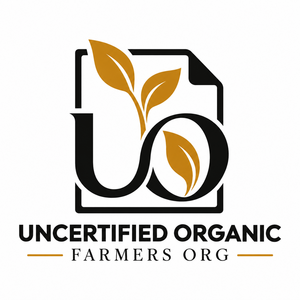

<!-- ::SECTION_START class="panel panel-1" -->

# Uncertified Organic Farmers Org

Sustainably grown. Honestly labeled.

<!-- ::SECTION_END -->

<!-- ::SECTION_START class="panel panel-2" -->

## What We Do

Uncertified Organic Farmers Org grows and distributes seasonal produce using sustainable field
rotation, companion planting, and minimal-input pest management — without chasing a formal
certification we think adds more paperwork than value.

- Seasonal fruit and vegetable crops
- Companion-planted pest management
- Cover-crop soil rebuilding between rotations
- Direct-to-market and farm-stand distribution

<!-- ::SECTION_END -->

<!-- ::SECTION_START class="panel panel-3" -->

## Get Involved

Address: 4400 Rural Route 9, Example, KY 41000

Phone: (555) 019-2000

Email: info@example.invalid

Web: www.uofo.example.invalid

Visit us Saturdays, 8am–1pm, at the Eastside Farmers Market — or ask about a standing produce-box subscription.

<!-- ::SECTION_END -->
